<h1 align="center">LLM Observability</h1>

<p align="center">
  <em>An LLM observability and tracing platform built from scratch: hierarchical spans, token / cost / latency metrics, and trace analysis.</em>
</p>

<p align="center">
  <a href="https://github.com/adeoluo/llm-observability/actions/workflows/ci.yml"></a>
  
  
  
  
  
</p>

---

## Motivation

You cannot improve what you cannot see. LLM applications are especially opaque: a single
user request fans out into nested model calls, tool calls, and retrieval steps, each with
its own latency, token usage, and dollar cost. This project builds the observability stack
for that world **from first principles** - spans, a trace tree, cost modeling, metric
aggregation, and regression detection - with **zero runtime dependencies** and a fully
deterministic, offline test suite.

The design follows OpenTelemetry's model (spans with parent/child structure) but is small
enough to read in an afternoon, so the mechanics of tracing are transparent rather than
hidden behind a vendor SDK.

## Architecture

<p align="center">
  
</p>

An instrumented application opens **spans** through the **Tracer**'s context manager; spans
nest automatically into a **trace tree**. The **cost model** and **metrics** layer turn
span attributes into tokens, dollars, and latency; **analysis** aggregates many traces into
percentiles and flags regressions. Traces render as a **waterfall tree** or serialize to
**JSON**. See the [ADRs](docs/adr/) for key choices.

## Components

- **Tracing** - `Span`, a `Trace` tree reconstructed from parent ids, and a context-managed
  `Tracer` that handles nesting and sets an ERROR status automatically on exceptions.
- **Cost** - `PriceList` maps models to per-million-token prices; `estimate_cost` turns
  token counts into dollars.
- **Metrics** - `record_llm_call` annotates a span; `aggregate_metrics` sums tokens, cost,
  latency, calls, and errors across a trace.
- **Analysis** - `summarize_batch` (p50/p95/p99 latency, totals) and `detect_regressions`
  (latency, cost-per-trace, and error-rate alerts between a baseline and a candidate).
- **Exporters** - waterfall tree rendering and lossless JSON serialization.

## Demonstration

Fully offline and deterministic, via `python -m llm_observability demonstrate`:

```text
Trace trace-1 (35000.0 ms)
- agent.run [ok] 35000.0 ms
  - llm.call [ok] 5000.0 ms
  - tool.exec [ok] 5000.0 ms
  - llm.call [ok] 5000.0 ms

2 calls, 842 tokens (in 730 / out 112), $0.0029, 35000.0 ms, 0 errors
```

## Quickstart

```bash
git clone https://github.com/adeoluo/llm-observability.git && cd llm-observability
make setup                    # install dev tooling + pre-commit hooks
make all                      # lint + type-check + test

python -m llm_observability demonstrate   # trace a simulated agent run
python -m llm_observability prices        # list built-in model prices
```

Instrument your own code:

```python
from llm_observability import Tracer
from llm_observability.metrics import record_llm_call, aggregate_metrics

tracer = Tracer()
with tracer.span("agent.run"):
    with tracer.span("llm.call") as span:
        # ... call your model ...
        record_llm_call(span, model="gpt-4o", input_tokens=320, output_tokens=48)

metrics = aggregate_metrics(tracer.traces()[0])
print(metrics.format())
```

## Design decisions

- **OpenTelemetry-style spans with a context variable.** Nesting is tracked implicitly, so
  a whole call tree is instrumented with `with` blocks and no parent threading.
  ([ADR-0002](docs/adr/0002-context-managed-spans.md))
- **Injected prices, not hard-coded.** The cost model takes a `PriceList`, so pricing stays
  current and testable. ([ADR-0003](docs/adr/0003-injected-cost-model.md))
- **Deterministic clock for reproducibility.** The tracer accepts a counter in place of the
  wall clock, so demonstrations and tests produce exact, stable numbers.

## Responsible AI

- **Model card:** [docs/MODEL_CARD.md](docs/MODEL_CARD.md)
- **Data card:** [docs/DATA_CARD.md](docs/DATA_CARD.md)
- **Threat model:** [docs/THREAT_MODEL.md](docs/THREAT_MODEL.md)

## Limitations

- In-memory tracing suited to a single process; distributed trace propagation across
  services is out of scope (a roadmap item).
- Cost figures are estimates from an injected price list, not billed amounts.
- Token counts are recorded by the caller; this project does not tokenize text itself.

## Roadmap

- [ ] Cross-process trace context propagation
- [ ] A live metrics endpoint and a web dashboard
- [ ] Sampling for high-volume production traffic

## License

[MIT](LICENSE). Part of a 28-project artificial intelligence engineering portfolio by
[adeoluo](https://github.com/adeoluo).
