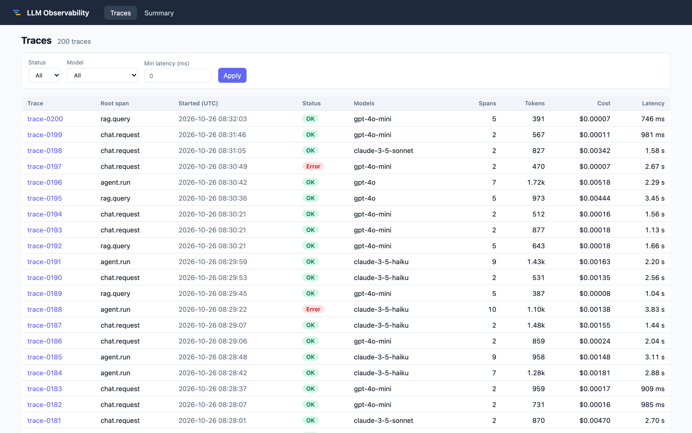
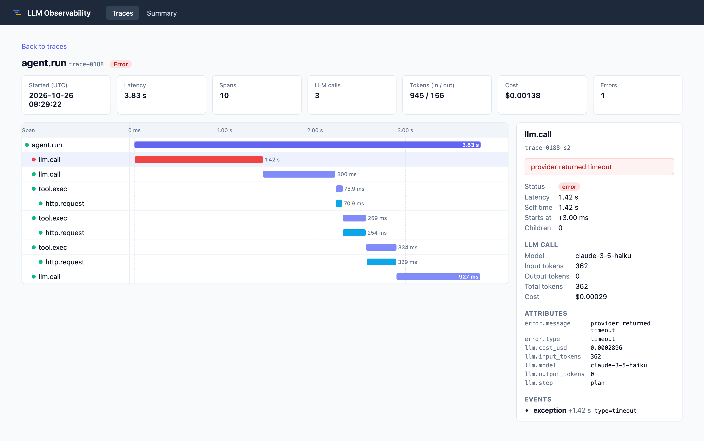
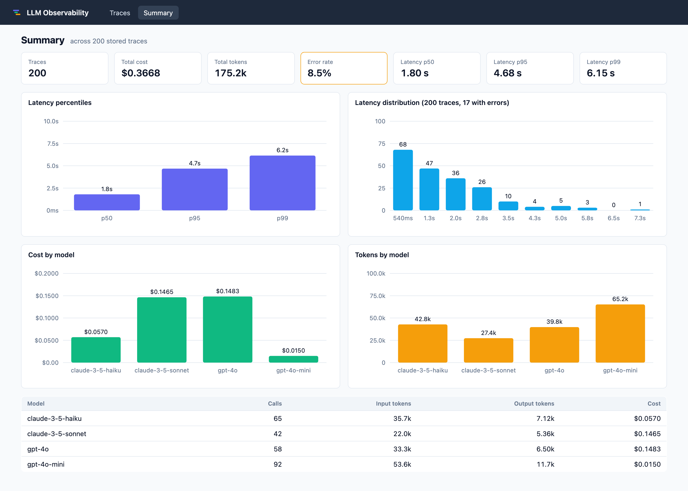
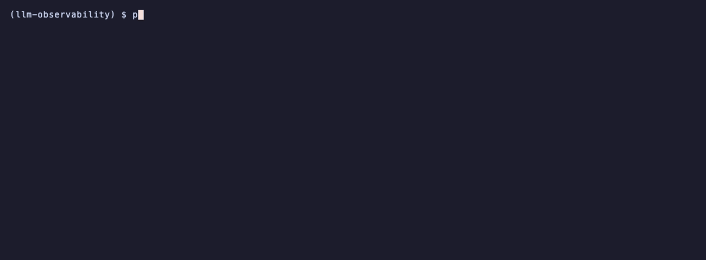
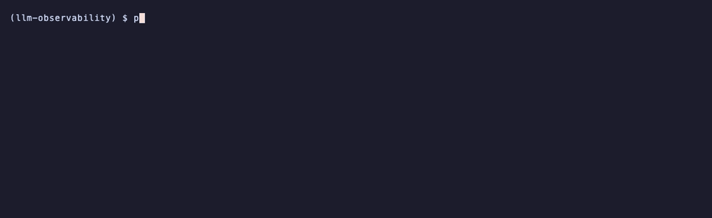
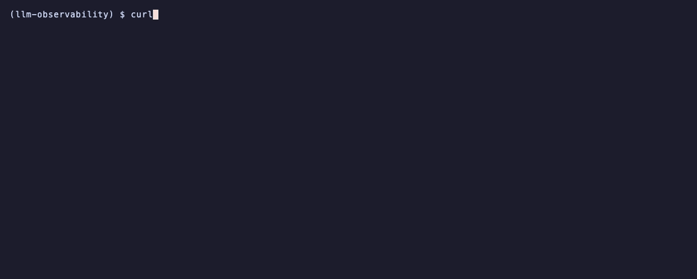

<h1 align="center">LLM Observability</h1>

<p align="center">
  <em>A Python and TypeScript toolkit that records each step of a large language model (LLM) application, with its time, tokens and cost, and shows the records in a web dashboard.</em>
</p>

<p align="center">
  <a href="https://github.com/adeoluo/llm-observability/actions/workflows/ci.yml"></a>
  <a href="https://github.com/adeoluo/llm-observability/releases"></a>
  
  
  <a href="LICENSE"></a>
</p>

---

> **Evidence level: unit tested.** The speed figures come from synthetic (program-generated) spans in a single process. No one has reproduced them independently, and the project has not been used in production.

## Highlights

One question to an AI application can start many hidden steps: calls to a large language
model (LLM), calls to tools, and document lookups. This toolkit records each step with its
duration, token count, cost and errors. The records show which steps are slow or expensive.

- **Recording steps adds little overhead.** On one Apple M1 laptop, the tracer records about
  194,000 steps (spans) per second. So each step costs a few microseconds, which is small
  compared with the model calls it measures.
- **Summarizing recorded requests is fast.** On the same laptop, it summarizes about 604,000
  traces per second into totals and latency figures. A trace is the full record of one
  request.
- **It flags regressions.** A library function compares a new batch of traces with an
  earlier batch. It reports when latency, cost per trace or error rate got worse by more than
  a set limit.
- **It includes a collector service and a web dashboard.** The collector receives traces
  over HTTP and keeps them in memory. The dashboard lists the traces, draws each one as a
  timeline, and charts latency, cost and tokens.

**Where it falls short:** the speed numbers come from synthetic data in one process. They
also depend on the machine: an outside review on a small virtual machine measured 24 to 35
times lower speeds. The toolkit has not been run on a live system.

## Key terms

Plain definitions of the terms used in this README.

| Term | Meaning |
|---|---|
| Aggregation | Combining many traces into totals (tokens, cost, errors) and latency percentiles. Aggregation time is in seconds; lower is better. |
| Collector | The HTTP service in this project. It receives traces from applications, checks each request, and keeps the traces in a bounded in-memory store. |
| Error budget | The part of the failures allowed by a service level objective that is still unused. It becomes negative when the objective is missed. |
| Error rate | The share of traces with at least one failed step, from 0 to 1. Lower is better. |
| Exporter | Code that writes a trace in another format: a text tree, JSON, the Chrome Trace format, or CSV (comma-separated values). |
| Global interpreter lock (GIL) | A lock in the standard Python interpreter that lets only one thread run Python code at a time. So extra threads do not speed up processor-heavy work. |
| Instrumentation | Code added to an application so that it records spans. Here that means `with tracer.span(...)` blocks or the `@instrument` decorator. |
| Large language model (LLM) | An AI model that reads and writes text, such as GPT-4o or Claude. Providers usually charge for it per token. |
| Latency | The time one step or one request takes, in milliseconds (ms). Lower is better. |
| MiB | Mebibyte, a unit of memory equal to 1,048,576 bytes (about 1.05 million bytes). |
| Observability | The ability to see what a running system does from the data it records, such as traces and metrics. |
| OpenTelemetry | A widely used open standard for traces and metrics. This project follows its span model but does not use its libraries. |
| Peak memory | The most memory that the measured work had allocated at any one moment, in MiB. Lower is better. |
| Percentile latency (p50, p95, p99) | The latency that 50, 95 or 99 percent of requests stay under. p50 is the typical case and p99 is the slow tail. Lower is better. |
| Price list | A table of model prices in US dollars per million input tokens and per million output tokens. Cost estimates come from it. |
| Prometheus | A widely used monitoring system. It reads metrics from services in a simple text format, which this service serves at `/metrics`. |
| Regression | A change that makes a system worse than an earlier version, for example slower, more costly or more error-prone. |
| Sampling | Keeping only some traces to save storage. The ratio sampler keeps a fixed share, chosen from a hash of the trace id, so the choice is repeatable. |
| Service level objective (SLO) | A target such as "95 percent of requests finish under 2 seconds". The SLO report states whether the target was met. |
| Span | One recorded step, such as a model call or a tool call. It has a name, start and end times, a status, and attributes such as tokens and cost. |
| Synthetic data | Data generated by a program instead of collected from real use. All benchmark figures in this README use synthetic data. |
| Throughput | How many items (spans, traces or call records) are processed per second. Higher is better. |
| Token | A small piece of text, often part of a word, that a language model reads or writes. Model cost is counted in tokens. |
| Trace | The full record of one request: a tree of spans in which each child span is a step inside its parent span. |
| Waterfall | A chart of one trace in which each span is a horizontal bar. The bar's position and length show when the span started and how long it took. |

## Motivation

It is hard to see what happens inside an LLM application. A single user request splits into
nested model calls, tool calls, and retrieval steps (lookups of documents to give the model).
Each step has its own latency, token use, and cost in dollars. This project provides the
parts needed to observe these steps:

- spans and a trace tree that record each step
- cost estimates from a price list
- totals and percentiles across many traces
- regression detection
- a collector service
- a web dashboard to browse what was recorded

The tracing model follows OpenTelemetry: spans have a parent and child structure. The code
stays small enough to read in an afternoon. So the way tracing works is visible, and not
hidden inside a vendor's software development kit (SDK). The Python tests are deterministic
(they give the same result on every run) and need no network access.

## Architecture

<p align="center">
  
</p>

<sub>Legend: amber marks entry points and external systems, indigo marks core logic, green marks data and state, blue marks validation and control, grey marks observability and outputs.</sub>

The diagram shows how data moves through the system:

1. An application opens spans through the Python `Tracer`, either directly or with the
   `@instrument` decorator. An optional sampler decides which traces to keep.
2. Spans nest into a trace tree. Each span carries the model name, token counts, and cost.
3. Exporters write the tree as JSON, a text tree, a Chrome trace (a format that browser
   timeline tools can open), or CSV.
4. Traces are posted to the collector, an HTTP server built on the Python
   standard library. The collector checks each request and keeps traces in a bounded
   in-memory store. Bounded means it holds a fixed maximum number of traces.
5. The analysis layer combines stored traces with the model price list. It computes cost,
   tokens, errors, and latency percentiles, and can check an SLO.
6. The TypeScript dashboard is built with Vite (a web build tool) and Preact (a small user
   interface library). The same Python process serves it at `/ui`. It reads only the JSON
   application programming interface (API).
7. `/metrics` reports request counts and latency for each route in the Prometheus text format.

See the [ADRs](docs/adr/) (architecture decision records, short notes that explain each key
design choice) for the main choices.

## Results

### Performance

> Measured with `uv run python benchmarks/benchmark.py`.

The table shows the speed of two core operations on synthetic data. Each row is one
operation, and the column gives its throughput in items per second (higher is better).

| Operation | Throughput |
|---|---:|
| Span create + finish (with attribute) | ~194,000 spans / sec |
| Batch aggregation into metrics | ~604,000 traces / sec |

So tracing adds a few microseconds per span, which is small compared with the model calls
it measures. These figures come from an idle Apple M1 laptop and change with the machine. A
second run on the same laptop gave about 170,000 and 541,000. An outside review on a small
virtual machine measured speeds 24 to 35 times lower.

### Scale

`benchmarks/scale.py` checks how the analysis behaves as the number of traces grows. It
creates larger and larger batches of synthetic traces, each with two spans. For each batch it
measures three things:

- the throughput of `summarize_batch`, which aggregates the batch into metrics
- the time of one `search_spans` query, which searches every span in the batch by name
- the peak memory of the aggregation and the query, measured with `tracemalloc` (the Python
  standard-library memory tracer).

The data is synthetic and the numbers depend on the machine. The trend matters more than the
exact values.

Each row in the table is one batch size, and each column is one measure. Lower is better for
time and memory, and higher is better for throughput.

| Synthetic traces | Aggregation (s) | Throughput (traces/s) | Peak memory (MiB) | Spans | Query (ms) |
|---:|---:|---:|---:|---:|---:|
| 5,000 | 0.157 | ~31,800 | 1.03 | 10,000 | 15.41 |
| 15,000 | 0.544 | ~27,600 | 3.08 | 30,000 | 61.70 |
| 30,000 | 1.082 | ~27,700 | 6.17 | 60,000 | 100.04 |
| 60,000 | 3.040 | ~19,700 | 12.35 | 120,000 | 310.90 |

Aggregation throughput stays roughly flat from 5,000 to 30,000 traces and drops at 60,000
traces. Memory and span count grow in proportion to the number of traces. Query time grows
with the number of spans searched.

Reproduce with `uv run python benchmarks/scale.py`.

### Service throughput

A stress benchmark (`uv run python benchmarks/stress.py`) sends batches of 100 synthetic call
records to the `POST /summarize` request handler. It calls the handler directly in the same
process, without a network. It reports ingest throughput and the p50, p95 and p99 latency of
the handler. With one worker thread, the handler takes in on the order of 160000 call records
per second. See the [operations guide](docs/OPERATIONS.md) for the measured service level
objectives.

## Quickstart

```bash
git clone https://github.com/adeoluo/llm-observability.git && cd llm-observability
make setup                    # install dev tooling + pre-commit hooks
make all                      # lint + type-check + test

python -m llm_observability demonstrate   # trace a simulated agent run
python -m llm_observability prices        # list built-in model prices
```

To see the dashboard with sample data, run the commands below. They need Node.js 20 or later
(a JavaScript runtime).

```bash
(cd web && npm ci && npm run build)
uv run python -m llm_observability serve --port 8000 --demo-traces 200
# open http://localhost:8000/ui/
```

## Usage

### Demonstration

The command `python -m llm_observability demonstrate` traces a simulated agent run. It needs
no network and prints the same output on every run:

```text
Trace trace-1 (35000.0 ms)
- agent.run [ok] 35000.0 ms
  - llm.call [ok] 5000.0 ms
  - tool.exec [ok] 5000.0 ms
  - llm.call [ok] 5000.0 ms

2 calls, 842 tokens (in 730 / out 112), $0.0026, 35000.0 ms, 0 errors
```

The dollar figure uses the bundled price list (`python -m llm_observability prices`). This
list is an example, not current vendor pricing. For real costs, pass your own `PriceList`.

### Library API

Instrument your own code:

```python
from llm_observability import Tracer
from llm_observability.metrics import record_llm_call, aggregate_metrics

tracer = Tracer()
with tracer.span("agent.run"):
    with tracer.span("llm.call") as span:
        # ... call your model ...
        record_llm_call(span, model="gpt-4o", input_tokens=320, output_tokens=48)

metrics = aggregate_metrics(tracer.traces()[0])
print(metrics.format())
```

The library is organized into these components:

- **Tracing**: `Span` records one step. `Trace` rebuilds the tree of spans from each span's
  parent id. `Tracer` opens spans in `with` blocks, keeps track of nesting, and sets an
  ERROR status when the code inside a span raises an exception. Spans can also carry events
  with timestamps, and the `@instrument` decorator traces a whole function.
- **Sampling**: `AlwaysSampler` keeps every trace. `RatioSampler` keeps a fixed share of
  traces for high-volume use. It decides from a hash of the trace id, so the same trace
  always gets the same decision.
- **Cost**: `PriceList` maps each model to its price per million tokens. `estimate_cost`
  turns token counts into dollars.
- **Metrics**: `record_llm_call` adds model and token details to a span. `aggregate_metrics`
  adds up tokens, cost, latency, calls, and errors across a trace.
- **Analysis**: `summarize_batch` gives totals and p50, p95 and p99 latency for a batch of
  traces. `detect_regressions` raises alerts when latency, cost or error rate got worse.
  `diff_traces` shows the differences in structure and timing between two traces.
- **Alerting and SLOs**: `AlertEngine` checks traces against rules for cost, latency, tokens
  and errors. `evaluate_slo` checks an SLO and reports the remaining error budget.
- **Search**: `search_spans` finds spans across traces by name, status, duration, and
  attributes.
- **Exporters**: a waterfall text tree, JSON that can be read back without loss, the Chrome
  Trace format (which `chrome://tracing` and Perfetto, two trace viewers, can open), and CSV.
- **Store**: `TraceStore` holds a bounded number of traces and is safe to use from several
  threads at once. The store module also builds the JSON views that the API serves.

### HTTP service

The service is built on the HTTP server in the Python standard library. It collects
traces, serves the JSON API and the dashboard, and summarizes batches of call records sent
in a request:

```bash
python -m llm_observability serve --port 8000

curl localhost:8000/health
curl -s -X POST localhost:8000/summarize -d '{
  "calls": [{"model": "gpt-4o", "input_tokens": 1000, "output_tokens": 300, "latency_ms": 820}],
  "slo_threshold_ms": 1000
}'

# send traces to the collector (body format of POST /api/traces)
python -m llm_observability sample-traces --count 50 --output traces.json
curl -s -X POST localhost:8000/api/traces -d @traces.json
curl -s 'localhost:8000/api/traces?status=error&min_latency_ms=1000'
curl -s localhost:8000/api/summary
```

The table lists each endpoint (an address on the service) in the first column and what it
does in the second.

| Endpoint | Purpose |
|---|---|
| `POST /api/traces` | ingest up to 1000 traces in the JSON form produced by `trace_to_dict` |
| `GET /api/traces` | trace rows, newest first; filters `status`, `model`, `min_latency_ms`, `limit` |
| `GET /api/traces/{id}` | one trace with its summary and every span |
| `GET /api/summary` | totals, error rate, latency p50/p95/p99, and a per-model breakdown |
| `POST /summarize` | cost, tokens, error rate, latency percentiles, and an optional SLO report |
| `GET /health`, `GET /ready`, `GET /metrics` | liveness, readiness, Prometheus text metrics |
| `GET /ui/` | the dashboard (static files from `web/dist`) |

Aggregation is limited by processor (CPU) speed and holds the global interpreter lock. So
the service handles more load when more processes run, not more threads. See the [operations guide](docs/OPERATIONS.md), the
[scaling and tradeoffs](docs/SCALING.md) document, and the [case study](docs/CASE_STUDY.md)
on measuring a model rollout.

### Dashboard

The dashboard in [`web/`](web/) is a single-page web application written in TypeScript with
strict type checks. It uses Preact to draw the page and Vite to build it. It has three views:

- **Traces**: the list of traces, with filters for status, model, and minimum latency. The
  filters are stored in the URL, so a filtered view can be shared as a link.
- **Trace detail**: a waterfall of nested spans. The position and width of each bar follow
  the span's start time and duration. A side panel shows tokens, cost, latency, self time
  (time not spent in child spans), errors, and span events.
- **Summary**: latency percentiles, a latency histogram, error rate, and cost and token
  totals per model. The charts are SVG (a vector image format) drawn by the project's own
  code, without a charting library.

Run it against the Python service:

```bash
cd web
npm ci
npm run build                 # writes web/dist, served by the service at /ui
cd ..
uv run python -m llm_observability serve --port 8000 --demo-traces 200
# open http://localhost:8000/ui/
```

Without Node.js, download `llm-observability-dashboard-<version>.zip` from the release. Unzip
it into `web/dist` inside the directory you run the service from, and start the service there.

For development, run `npm run dev` in `web/`. It starts Vite with hot reload (the page
updates when the code changes). It forwards `/api` requests to the service at
`http://127.0.0.1:8000`, and `LLM_OBS_API` sets a different address. The `--demo-traces N`
option loads N sample traces at start. The samples are generated from a fixed seed, so they
are the same on every run. They include chat, retrieval, and agent runs across four models,
with occasional provider errors and retries. The `--ui-dir PATH` option serves a dashboard
build from another directory. The Docker image builds the dashboard and serves it on port 8000.

<p align="center">
  
</p>

<p align="center">
  
</p>

<p align="center">
  
</p>

### Demos

These recordings come from real runs, made with [vhs](https://github.com/charmbracelet/vhs) (a tool that records terminal sessions). Each recording script is in `docs/demo/`.

A traced agent run: spans, token counts, and cost.

<p align="center">
  
</p>

The price table used for cost attribution.

<p align="center">
  
</p>

The collector: ingest 50 sample traces, filter slow errors, and summarize latency and cost by model.

<p align="center">
  
</p>

## Design decisions

- **OpenTelemetry-style spans with a context variable.** A Python context variable stores
  the current span, so the tracer knows the parent of each new span. A whole call tree is
  traced with `with` blocks, and no code has to pass parent spans around.
  ([ADR-0002](docs/adr/0002-context-managed-spans.md))
- **Prices are passed in, not written into the code.** The cost model takes a `PriceList`
  as input. So prices can be kept current, and tests can use fixed prices.
  ([ADR-0003](docs/adr/0003-injected-cost-model.md))
- **A deterministic clock makes results repeatable.** The tracer can use a counter instead
  of the real clock. So the demonstration and the tests produce exact numbers that never
  change.
- **The dashboard depends only on the JSON API.** The service computes the summary figures.
  The dashboard only sorts trace durations into bins for its latency histogram. The
  TypeScript client checks each response when it arrives. It keeps layout math (waterfall
  positions, axis ticks, chart geometry) in pure functions, which have no side effects and
  are unit tested without a browser.
- **One process serves the API and the user interface.** The built dashboard is a set of
  static files under `/ui`. So there is no separate web server to deploy, and no
  cross-origin setup (browser rules for pages that call another server) is needed.

## Testing

```bash
make all                                  # ruff format check, ruff lint, mypy, pytest with coverage gate
uv run pytest --cov=src --cov-fail-under=80

cd web
npm run typecheck                         # tsc --noEmit (strict)
npm test                                  # vitest
npm run build
```

- **Python (pytest, a Python test runner, 109 tests):** the tests cover the basic tracing
  types, cost and metrics, exporters, analysis, alerting and SLOs, search, sampling, and
  the command-line interface (CLI). They also cover the service handler for every route,
  including filters, invalid requests, and 404 (not found) responses. Other tests cover
  the trace store (eviction of old traces, replacement, summaries), safe lookup of static
  files for `/ui`, and the sample-trace generator. Continuous integration (CI, the checks
  that run automatically on each change) fails if tests cover less than 80 percent of the
  code.
- **TypeScript (vitest, a TypeScript test runner, 54 tests):** the tests cover the
  waterfall layout math: ordering, bar offsets and widths, self time, open and orphan spans
  (spans with no end time or no known parent), parent cycles, and axis ticks. They also
  cover the formatting of durations, costs, tokens, and percentages, and the API client's
  parsing and error handling with a stand-in `fetch`. Hash routing (page addresses after
  `#` in the URL) and chart geometry are tested too.
- CI runs the Python job on Python 3.12, 3.13, 3.14 and 3.15. It also runs a `web` job
  (`npm ci`, type check, tests, build) and builds the package and the Docker image.

## Responsible AI

- **Model card:** [docs/MODEL_CARD.md](docs/MODEL_CARD.md)
- **Data card:** [docs/DATA_CARD.md](docs/DATA_CARD.md)
- **Threat model:** [docs/THREAT_MODEL.md](docs/THREAT_MODEL.md)

## Limitations

- Tracing is in memory and suits a single process. Passing trace context between services
  (distributed tracing) is out of scope for now. It is a roadmap item.
- The collector's trace store is in memory and bounded: when it is full, the oldest traces
  are removed. Traces are lost when the service restarts.
- The service has no authentication. Run it on a trusted network or behind a proxy.
- Cost figures are estimates from a price list passed in by the caller, not billed amounts.
- The caller records token counts. This project does not split text into tokens itself.

## Roadmap

- [ ] Cross-process trace context propagation
- [ ] A durable trace store behind the existing store interface
- [ ] Sampling for high-volume production traffic
- [ ] Time-window charts on the dashboard summary

## License

Released under the [MIT License](LICENSE).
