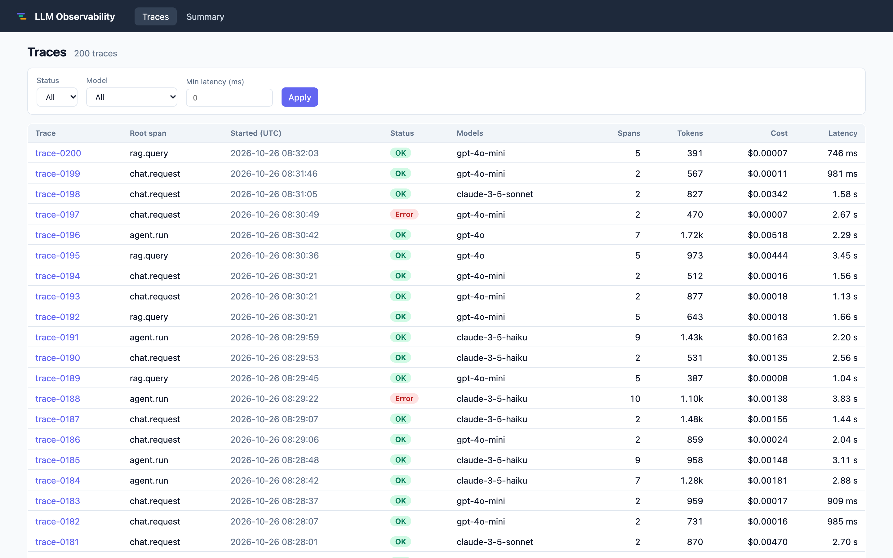
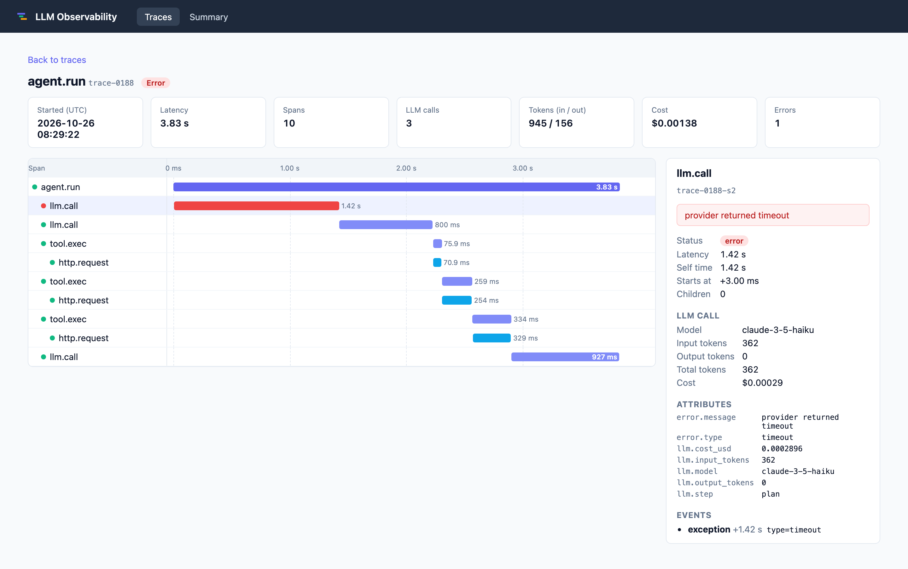
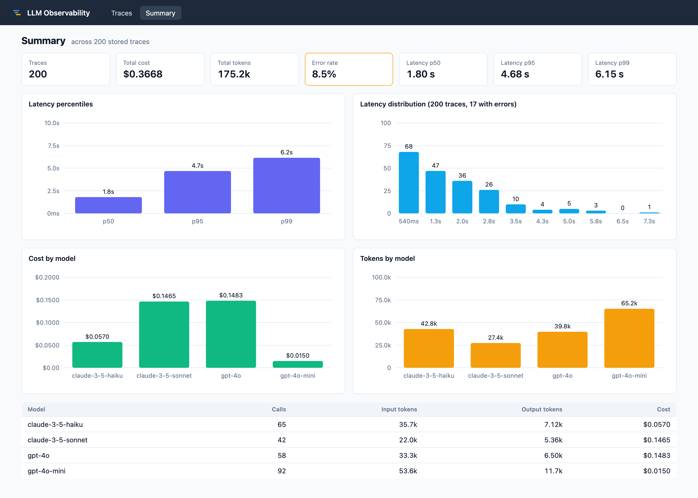
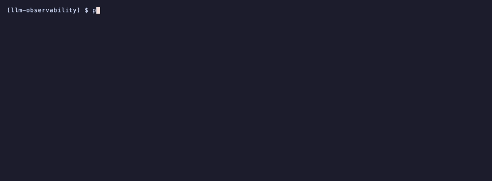
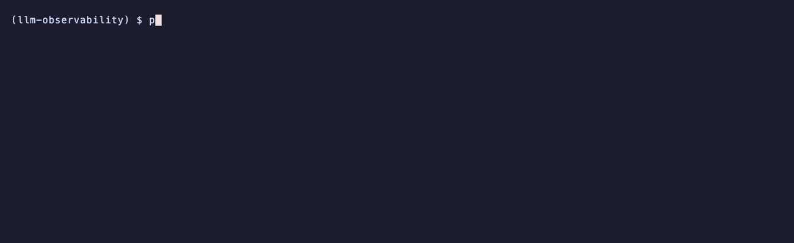
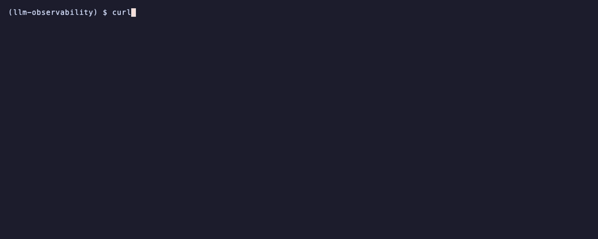

<h1 align="center">LLM Observability</h1>

<p align="center">
  <em>LLM tracing with a Python library and collector service, a JSON API, and a TypeScript dashboard for traces, latency, tokens, and cost.</em>
</p>

<p align="center">
  <a href="https://github.com/adeoluo/llm-observability/actions/workflows/ci.yml"></a>
  <a href="https://github.com/adeoluo/llm-observability/releases"></a>
  
  
  <a href="LICENSE"></a>
</p>

---

## Motivation

LLM applications are hard to see into. A single user request fans out into nested model
calls, tool calls, and retrieval steps, each with its own latency, token usage, and dollar
cost. This project provides the pieces needed to observe that: spans and a trace tree, cost
modeling, metric aggregation, regression detection, a collector service, and a web
dashboard for browsing what was recorded.

The tracing model follows OpenTelemetry (spans with parent and child structure) but stays
small enough to read in an afternoon, so the mechanics of tracing are visible rather than
hidden behind a vendor SDK. The Python test suite is deterministic and runs offline.

## Architecture

<p align="center">
  
</p>

<sub>Legend: amber = entry points and external systems, indigo = core logic, green = data and state, blue = validation and control, grey = observability and outputs.</sub>

An instrumented application opens spans through the Python `Tracer` (directly or with the
`@instrument` decorator), and an optional sampler decides which traces to keep. Spans nest
into a trace tree and carry model, token, and cost attributes; exporters serialize the tree to
JSON (or a text tree, Chrome trace, or CSV). Traces are posted to the standard-library HTTP
collector, which validates each request and keeps traces in a bounded in-memory store. The
analysis layer combines stored traces with the model price list to produce cost, token,
error, and latency percentile figures, with an optional SLO check. The TypeScript dashboard,
built with Vite and Preact and served by the same Python process at `/ui`, reads only the
JSON API, and `/metrics` exposes per-route request counts and latency in Prometheus format.
See the [ADRs](docs/adr/) for key choices.

## Results

### Performance

> Measured with `uv run python benchmarks/benchmark.py`.

| Operation | Throughput |
|---|---:|
| Span create + finish (with attribute) | ~194,000 spans / sec |
| Batch aggregation into metrics | ~604,000 traces / sec |

Tracing overhead is a few microseconds per span, which is small relative to the model calls
it measures.

### Scale

To check how analysis holds up as trace volume grows, `benchmarks/scale.py` ingests
increasing batches of synthetic traces and measures `summarize_batch` throughput, a span
`search_spans` query across the whole batch, and peak memory (the aggregation and query
allocations, via the standard-library `tracemalloc`). The data is synthetic and the
numbers are environment-specific, but the shape is the point: aggregation throughput stays
roughly flat, memory and span count grow linearly, and query latency grows with the number
of spans scanned.

| Traces | Aggregation (s) | Throughput (traces/s) | Peak memory (MiB) | Spans | Query (ms) |
|---:|---:|---:|---:|---:|---:|
| 5,000 | 0.157 | ~31,800 | 1.03 | 10,000 | 15.41 |
| 15,000 | 0.544 | ~27,600 | 3.08 | 30,000 | 61.70 |
| 30,000 | 1.082 | ~27,700 | 6.17 | 60,000 | 100.04 |
| 60,000 | 3.040 | ~19,700 | 12.35 | 120,000 | 310.90 |

Reproduce with `uv run python benchmarks/scale.py`.

### Service throughput

A stress benchmark (`uv run python benchmarks/stress.py`) reports ingest throughput and
p50/p95/p99 handler latency for `POST /summarize`; a single core ingests on the order of
160000 call records per second in batches. See the [operations guide](docs/OPERATIONS.md)
for the measured service level objectives.

## Quickstart

```bash
git clone https://github.com/adeoluo/llm-observability.git && cd llm-observability
make setup                    # install dev tooling + pre-commit hooks
make all                      # lint + type-check + test

python -m llm_observability demonstrate   # trace a simulated agent run
python -m llm_observability prices        # list built-in model prices
```

To see the dashboard with sample data (requires Node.js 22.12 or later):

```bash
(cd web && npm ci && npm run build)
uv run python -m llm_observability serve --port 8000 --demo-traces 200
# open http://localhost:8000/ui/
```

## Usage

### Demonstration

Offline and deterministic, via `python -m llm_observability demonstrate`:

```text
Trace trace-1 (35000.0 ms)
- agent.run [ok] 35000.0 ms
  - llm.call [ok] 5000.0 ms
  - tool.exec [ok] 5000.0 ms
  - llm.call [ok] 5000.0 ms

2 calls, 842 tokens (in 730 / out 112), $0.0029, 35000.0 ms, 0 errors
```

### Library API

Instrument your own code:

```python
from llm_observability import Tracer
from llm_observability.metrics import record_llm_call, aggregate_metrics

tracer = Tracer()
with tracer.span("agent.run"):
    with tracer.span("llm.call") as span:
        # ... call your model ...
        record_llm_call(span, model="gpt-4o", input_tokens=320, output_tokens=48)

metrics = aggregate_metrics(tracer.traces()[0])
print(metrics.format())
```

The library is organized into these components:

- **Tracing**: `Span`, a `Trace` tree reconstructed from parent ids, and a context-managed
  `Tracer` that handles nesting and sets an ERROR status automatically on exceptions.
  Spans also carry timestamped events, and the `@instrument` decorator traces a function.
- **Sampling**: `AlwaysSampler` and a deterministic `RatioSampler` (hash of the trace id)
  to keep a stable fraction of traces in high-volume settings.
- **Cost**: `PriceList` maps models to per-million-token prices; `estimate_cost` turns
  token counts into dollars.
- **Metrics**: `record_llm_call` annotates a span; `aggregate_metrics` sums tokens, cost,
  latency, calls, and errors across a trace.
- **Analysis**: `summarize_batch` (p50/p95/p99 latency, totals), `detect_regressions`
  (latency, cost, and error-rate alerts), and `diff_traces` (structural and timing delta
  between two traces).
- **Alerting and SLOs**: a rule engine (`AlertEngine` with cost, latency, token, and error
  rules) and `evaluate_slo` with an error-budget readout.
- **Search**: `search_spans` filters spans across traces by name, status, duration, and
  attributes.
- **Exporters**: waterfall tree rendering, lossless JSON, the Chrome Trace format
  (loadable in `chrome://tracing` or Perfetto), and CSV.
- **Store**: a bounded, thread-safe `TraceStore` and the JSON views the API serves.

### HTTP service

The service is built on the Python standard library HTTP server. It collects traces,
serves the JSON API and the dashboard, and summarizes ad hoc batches of call records:

```bash
python -m llm_observability serve --port 8000

curl localhost:8000/health
curl -s -X POST localhost:8000/summarize -d '{
  "calls": [{"model": "gpt-4o", "input_tokens": 1000, "output_tokens": 300, "latency_ms": 820}],
  "slo_threshold_ms": 1000
}'

# send traces to the collector (body format of POST /api/traces)
python -m llm_observability sample-traces --count 50 --output traces.json
curl -s -X POST localhost:8000/api/traces -d @traces.json
curl -s 'localhost:8000/api/traces?status=error&min_latency_ms=1000'
curl -s localhost:8000/api/summary
```

| Endpoint | Purpose |
|---|---|
| `POST /api/traces` | ingest up to 1000 traces in the JSON form produced by `trace_to_dict` |
| `GET /api/traces` | trace rows, newest first; filters `status`, `model`, `min_latency_ms`, `limit` |
| `GET /api/traces/{id}` | one trace with its summary and every span |
| `GET /api/summary` | totals, error rate, latency p50/p95/p99, and a per-model breakdown |
| `POST /summarize` | cost, tokens, error rate, latency percentiles, and an optional SLO report |
| `GET /health`, `GET /ready`, `GET /metrics` | liveness, readiness, Prometheus text metrics |
| `GET /ui/` | the dashboard (static files from `web/dist`) |

Aggregation is CPU bound and holds the global interpreter lock, so the service scales with
processes. See the [operations guide](docs/OPERATIONS.md), the
[scaling and tradeoffs](docs/SCALING.md) document, and the [case study](docs/CASE_STUDY.md)
on measuring a model rollout.

### Dashboard

The dashboard in [`web/`](web/) is a single-page TypeScript application (strict mode,
Preact for rendering, Vite for the build). It has three views:

- **Traces**: the trace list with filters for status, model, and minimum latency. Filters
  live in the URL, so a filtered view can be shared.
- **Trace detail**: a nested span waterfall whose bar offsets and widths are proportional
  to each span's start and duration, next to an attribute panel showing tokens, cost,
  latency, self time, errors, and span events.
- **Summary**: latency percentiles, a latency histogram, error rate, and cost and token
  totals per model, drawn as SVG charts in plain code with no charting library.

Run it against the Python service:

```bash
cd web
npm ci
npm run build                 # writes web/dist, served by the service at /ui
cd ..
uv run python -m llm_observability serve --port 8000 --demo-traces 200
# open http://localhost:8000/ui/
```

For development, `npm run dev` in `web/` starts Vite with hot reload and proxies `/api` to
the service at `http://127.0.0.1:8000` (override with `LLM_OBS_API`). `--demo-traces N`
preloads N seeded sample traces (chat, retrieval, and agent runs across four models, with
occasional provider errors and retries); `--ui-dir PATH` serves a build from another
directory. The Docker image builds the dashboard and serves it on port 8000.

<p align="center">
  
</p>

<p align="center">
  
</p>

<p align="center">
  
</p>

### Demos

Recorded from real runs with [vhs](https://github.com/charmbracelet/vhs); each tape is in `docs/demo/`.

A traced agent run: spans, token counts, and cost.

<p align="center">
  
</p>

The price table used for cost attribution.

<p align="center">
  
</p>

The collector: ingest 50 sample traces, filter slow errors, and summarize latency and cost by model.

<p align="center">
  
</p>

## Design decisions

- **OpenTelemetry-style spans with a context variable.** Nesting is tracked implicitly, so
  a whole call tree is instrumented with `with` blocks and no parent threading.
  ([ADR-0002](docs/adr/0002-context-managed-spans.md))
- **Injected prices, not hard-coded.** The cost model takes a `PriceList`, so pricing stays
  current and testable. ([ADR-0003](docs/adr/0003-injected-cost-model.md))
- **Deterministic clock for reproducibility.** The tracer accepts a counter in place of the
  wall clock, so demonstrations and tests produce exact, stable numbers.
- **The dashboard depends only on the JSON API.** The service computes every summary; the
  TypeScript client validates each response at the boundary and keeps layout math
  (waterfall positions, axis ticks, chart geometry) in pure functions that are unit tested
  without a browser.
- **One process serves the API and the UI.** The built dashboard is static files under
  `/ui`, so there is no separate web server to deploy and no cross-origin setup.

## Testing

```bash
make all                                  # ruff format check, ruff lint, mypy, pytest with coverage gate
uv run pytest --cov=src --cov-fail-under=80

cd web
npm run typecheck                         # tsc --noEmit (strict)
npm test                                  # vitest
npm run build
```

- **Python (pytest, 108 tests):** tracing primitives, cost and metrics, exporters,
  analysis, alerting and SLOs, search, sampling, the CLI, the service handler for every
  route (including filters, validation errors, and 404s), the trace store (eviction,
  replacement, summaries), safe static file resolution for `/ui`, and the sample-trace
  generator. Coverage is gated at 80 percent in continuous integration.
- **TypeScript (vitest, 54 tests):** waterfall layout math (ordering, proportional
  offsets and widths, self time, open and orphan spans, parent cycles, axis ticks),
  formatting of durations, costs, tokens, and percentages, API client parsing and error
  handling with a stubbed `fetch`, hash routing, and chart geometry.
- Continuous integration runs the Python job on 3.11 and 3.12, a `web` job (`npm ci`,
  type check, tests, build), and a package and Docker image build.

## Responsible AI

- **Model card:** [docs/MODEL_CARD.md](docs/MODEL_CARD.md)
- **Data card:** [docs/DATA_CARD.md](docs/DATA_CARD.md)
- **Threat model:** [docs/THREAT_MODEL.md](docs/THREAT_MODEL.md)

## Limitations

- Tracing is in memory and suited to a single process; distributed trace propagation
  across services is out of scope (a roadmap item).
- The collector's trace store is in memory and bounded (oldest traces are evicted); it is
  not durable across restarts.
- The service has no authentication; run it on a trusted network or behind a proxy.
- Cost figures are estimates from an injected price list, not billed amounts.
- Token counts are recorded by the caller; this project does not tokenize text itself.

## Roadmap

- [ ] Cross-process trace context propagation
- [ ] A durable trace store behind the existing store interface
- [ ] Sampling for high-volume production traffic
- [ ] Time-window charts on the dashboard summary

## License

Released under the [MIT License](LICENSE).
